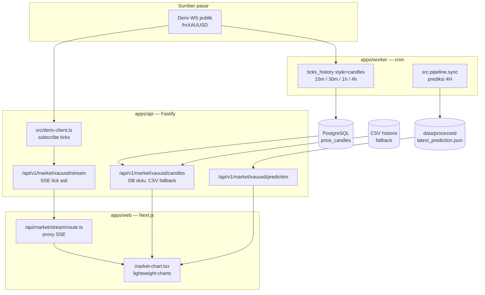
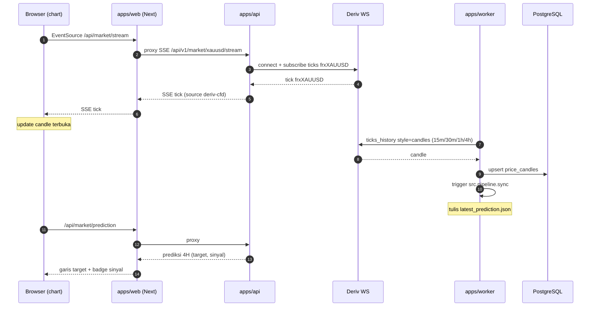

# XAUUSD Live Chart & Prediksi — Design Document

Status: siap dieksekusi.
Sumber keputusan: sesi brainstorming 2026-11-18.
Lingkup: chart pasar XAUUSD di `apps/web` + API + worker + DB. Bukan app baru.

## 1. Ringkasan Pemahaman

Masalah:
- Chart XAUUSD di `apps/web/src/components/market-chart.tsx` "realtime", tapi tick-nya
  `Math.random()` di dua tempat: `apps/web/src/app/api/market/stream/route.ts` dan
  `apps/api/src/server.ts` (`/api/v1/market/xauusd/stream`). Bukan harga pasar.

Tujuan:
- Chart pasar live beneran dari Deriv (WebSocket publik, symbol `frxXAUUSD`).
- Prediksi model 4H jadi fitur utama (garis target + badge sinyal).
- Data candle 15m/30m/1h/4h disimpan ke PostgreSQL (`price_candles`).

Batas:
- Deriv = CFD Gold/USD Deriv, bukan spot interbank.
- Jam trading Gold Deriv: ~Sun 22:10–Fri 21:55 UTC, ada daily break.
- Model/training TIDAK diubah. Pipeline training TIDAK diubah.
- Timeframe chart: 15m, 30m, 1h, 4h saja (sementara).
- Chart nggak nyampur candle Deriv & CSV dalam satu hitungan.

## 2. Arsitektur Teknis & Delegasi Skill

Alur (opsi A — Deriv WS sentral di apps/api):

Delegasi skill saat eksekusi:
- `real-time-market-chart-pipeline` — pola WS -> SSE, reconnect/backoff.
- `drizzle-orm-patterns` + `postgresql-table-design` — upsert, idempotency, indeks.
- `data-pipeline-integrity-audit` — provenance, pemisahan sumber.

## 3. Data Flow & Mutasi

Tick live:
- `apps/api` buka `wss://ws.deriv.com/websockets/v3?app_id=$DERIV_APP_ID`.
- Kirim `{ticks: "frxXAUUSD", subscribe: 1}`.
- Setiap tick -> broadcast SSE `{timestampUtc, price, bid, ask, source:"deriv-cfd", isSimulated:false}`.
- Reconnect otomatis + backoff; kalau gagal/koneksi mati -> kirim `status:"market_closed"`.

Candle ke DB:
- Worker cron (jadwal existing) panggil Deriv `ticks_history` dengan `style:"candles"`,
  granularity 900/1800/3600/14400, symbol `frxXAUUSD`.
- Baris: `id = XAUUSD_{tf}_{timestampUtc}`, `symbol="XAUUSD"`, `timeframe="15m|30m|1h|4h"`.
- Upsert ke `price_candles` dengan `onConflictDoUpdate` (pola di `apps/worker/src/index.ts`).
- Tick live TIDAK disimpan (hindari tabel tick gede). Yang disimpan candle 15m/30m/1h/4h.
- API stream TIDAK menulis DB. Worker satu-satunya penulis candle.

Chart historical:
- `/api/v1/market/xauusd/candles` + `/api/market/candles`: DB (Deriv) dulu,
  fallback CSV (`xauusd_h1_complete.csv` / `xauusd_m15.csv`) kalau kosong.
- Response bawa `source` + `isSimulated`.

Prediksi:
- Worker trigger `python -m src.pipeline.sync` (sudah ada).
- File `services/sentiment-analysis/data/processed/latest_prediction.json`.
- Endpoint `/api/v1/market/xauusd/prediction` baca file itu (cache singkat).
- `apps/web` proxy `/api/market/prediction`.

## 4. Provenance & Keamanan

- Env baru: `DERIV_APP_ID` di `.env` (belum ada; isi user). App ID Deriv = publik, bukan secret.
  Jangan pernah menaruh API token/secret Deriv di repo.
- Label sumber:
  - Deriv -> `source:"deriv-cfd"`, `isSimulated:false`.
  - CSV historis -> `source:"csv-historical"`.
- Badge di chart: "Deriv CFD" vs "Historical CSV".
- Panel prediksi wajib mencantumkan: timestamp prediksi, bucket time, horizon 4H,
  dan peringatan "Deriv CFD, bukan spot interbank".
- Chart menampilkan harga terakhir + label saat market tutup/WS mati.

## 5. Log Keputusan

| # | Keputusan | Alternatif | Rasional |
|---|-----------|------------|----------|
| 1 | Sumber live = Deriv WS publik `frxXAUUSD` | Alpha Vantage/Twelve Data (REST), broker OANDA/MT5 | WS publik tanpa auth, symbol emas ada, tick asli |
| 2 | WS Deriv di apps/api (sentral) | browser konek langsung; worker pegang WS | DB & chart satu sumber kebenaran; provenance terpusat |
| 3 | Simpan candle 15m/30m/1h/4h; tick live nggak disimpan | simpan semua tick | hindari data gede; tick cukup untuk chart |
| 4 | Candle dari `ticks_history style=candles` | agregasi tick manual | akurat, sesuai sumber, hemat |
| 5 | CSV historis tetap fallback | lepas sama sekali | Deriv bisa mati; label provenance beda |
| 6 | Prediksi 4H fitur utama | prediksi non-goal | user: "prediksi itu jadi utama" |
| 7 | Chart tf 15m/30m/1h/4h | tambah 5m/1D | user: "udah itu saja dulu" |

## 6. Risiko & Mitigasi

- Deriv CFD != spot interbank -> peringatan eksplisit; jangan campur dengan data historis di model.
- Granularity 14400 (4h) belum diuji -> kalau Deriv menolak, fallback agregasi dari 1h.
- WS Deriv bisa jeda/tidak sepadat feed institusional -> chart 15m/30m/1h/4h tetap mulus.
- Dua sumber candle beda definisi -> provenance wajib dibawa di API & chart.
- `DERIV_APP_ID` kosong -> api stream kirim `status:"unavailable"`, chart fallback DB/CSV.
- Next proxy SSE bisa tambah latency tipis -> terima; jalur API direct tetap ada.

## 7. Rencana Eksekusi (berurutan)

1. Tambah env `DERIV_APP_ID` di `.env.example` (nilai di `.env` oleh user).
2. Tambah dependency WS di `apps/api` (`ws` + `@types/ws`), atau pakai WebSocket bawaan Node 22.
3. `apps/api/src/deriv-client.ts`: koneksi, subscribe, reconnect, heartbeat.
4. Ganti isi `/api/v1/market/xauusd/stream` (api) dari Math.random ke tick Deriv.
5. Ubah `apps/web/src/app/api/market/stream/route.ts` jadi proxy SSE ke api.
6. Worker: tambah ingest candle Deriv 15m/30m/1h/4h -> `price_candles` (upsert).
7. API: `/api/v1/market/xauusd/candles` baca DB dulu, fallback CSV; bawa `source`.
8. API: endpoint `/api/v1/market/xauusd/prediction`.
9. Web: proxy `/api/market/prediction`; chart garis target + badge sinyal; panel prediksi; tf switcher 4 opsi; provenance badge.
10. Verifikasi: `bun run check-types`, `bun run lint`, `bun run test`, `bun run build`.

## 8. Yang TIDAK Dilakukan

- Nggak ubah model, training, pipeline training.
- Nggak campur sumber Deriv & CSV dalam hitungan model.
- Nggak tambah 5m/1D ke chart (sementara).
- Nggak simpan tick live mentah.

## 9. Pertanyaan Terbuka

- Granularity 4h Deriv: perlu uji. Kalau nggak ada, agregasi dari 1h.
- Format `id` candle Deriv mengikuti konvensi existing (`XAUUSD_{tf}_{ts}`).
