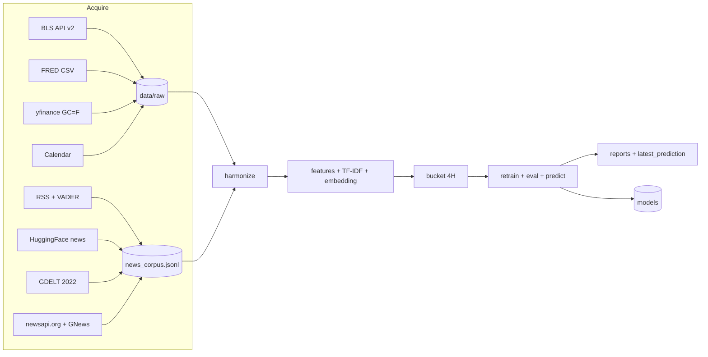

# XAUUSD Market Intelligence Terminal

Sistem informasi pasar emas (XAUUSD) dan analisis dampak rilis berita makro.
Monorepo **Bun + TypeScript** (Next.js, Fastify) dengan service **Python (uv)**
untuk pipeline data dan ML.

- **Repo:** https://github.com/fiyanz/xauusd-news-sentiment
- **Data:** https://www.kaggle.com/datasets/kyoushin/xauusd-news-sentiment-data

> **Integritas data:** seluruh angka analisis bersumber dari data nyata
> (BLS, FRED, yfinance, RSS, CFTC) dan setiap artifact membawa metadata
> *provenance*. Bila sumber tidak tersedia, sistem mengembalikan
> `status: "unavailable"` — bukan angka karangan.

---

## 1. Struktur Repo

```text
sistem-informasi-market-xauusd/
├── apps/
│   ├── api/          # REST + SSE (Fastify) — harga, kalender, event study, COT, digest
│   ├── web/          # Terminal chart (Next.js 15 + lightweight-charts) + API routes
│   └── worker/       # Scheduled ingestion pipeline
├── packages/
│   ├── types/              # Skema Zod bersama (OHLCV, COT, dst.)
│   ├── database/           # Skema Drizzle (PostgreSQL) + migrasi
│   ├── core-analytics/     # Surprise, reaction windows, agregasi event study
│   └── financial-clients/  # Kalender, COT CFTC, candle XAUUSD
├── services/
│   └── sentiment-analysis/ # Pipeline Python: acquire → process → features → ML
├── docs/                   # PRD, arsitektur, diagram
├── .agents/skills/         # Skill agent (Claude Code / Hermes)
└── .env.example
```

## 2. Quickstart

```bash
# 1. Dependensi TypeScript (Bun)
bun install

# 2. Service Python
cd services/sentiment-analysis
uv sync
uv run python -m nltk.downloader vader_lexicon   # sekali saja

# 3. Database PostgreSQL
#    Salin .env.example ke .env (root) dan sesuaikan DATABASE_URL.
cd ../../packages/database
bun run db:migrate        # menerapkan migration dari ./drizzle

# 4. Pipeline data + ML (opsional: config default memakai artifact repo)
cd ../../services/sentiment-analysis
uv run python -m src.pipeline.sync

# 5. Jalankan aplikasi (dari root)
bun run dev
#   web    -> http://localhost:3000
#   api    -> http://localhost:4000
#   worker -> bun x tsx apps/worker/src/index.ts
```

## 3. Sumber Data (keyless)

| Kebutuhan | Sumber | Keterangan |
|---|---|---|
| Actual CPI / core CPI / NFP | BLS API v2 | Tanpa key (batas 25 query/hari, di-cache) |
| Core PCE, FOMC target rate | FRED CSV publik | `fredgraph.csv?id=...` |
| H1 history + intraday 5m/15m | yfinance `GC=F` | Intraday maks ~60 hari |
| Berita & sentimen | RSS + VADER, HuggingFace, GDELT, newsapi.org, GNews | Lihat §3.1 |
| COT | CFTC `deafut.txt` | Non-commercial long/short emas |
| Forecast konsensus | — | Tidak ada sumber keyless; surprise = actual − previous |

### 3.1 Sumber berita (korpus 35.100 artikel)

| Sumber | Isi | Volume | Catatan |
|---|---|---|---|
| HuggingFace `ashraq/financial-news` | judul | 12.471 | Snapshot 2010–2020, keyless |
| GDELT News Headlines 2022 | judul | 20.629 | Keyless, dataset HF |
| HuggingFace `ashraq/financial-news-articles` | **isi** | 563 | 2018 |
| HuggingFace `openalphalab/gdelt-news` | **isi** | 430 | 2020 |
| newsapi.org (`NEWS_API_KEY`) | **isi** | ~363 | Berita terkini, 1 halaman/query |
| GNews (`GNEWS_API_KEY`) | **isi** | ~40 | Berita terkini |
| RSS (9 feed) | judul + ringkasan | ~465 | ~14 hari terakhir |

Key dibaca dari `.env` (repo root). Hanya ~5,6% artikel yang punya isi penuh;
sisanya judul saja. API gratis hanya untuk berita **terkini**, bukan historis.

`config.yaml` (`services/sentiment-analysis`) memegang daftar feed, ticker makro,
dan *lookback* berita. Path dataset eksternal (`price_file_raw`,
`calendar_file_raw`) bersifat opsional; bila `null`, pipeline memakai artifact
yang sudah ada di repo.

## 4. Pipeline Data & ML

Alur lengkap (`src/pipeline/sync.py`):

```text
price → intraday → macro → calendar → news → harmonize
      → features → buckets → retrain → evaluate → predict → provenance
```



- **Bucket full-history** (`src/process/price_buckets.py`, `data.bucket_mode:
  price_history`): bucket dibuat untuk **seluruh history harga** (2010–2026,
  ~26k bucket 4H), fitur berita netral (0) bila tidak ada artikel. Ukuran sampel
  tidak lagi dibatasi cakupan berita, sehingga evaluasi benar-benar bermakna.
  Mode `news_only` (bucket hanya saat ada artikel) masih tersedia.
  `split_mode: chronological | news_era` memilih cara pembagian train/test.

- **Retrain stage** (`src/pipeline/retrain.py`) menjalankan `train → significance
  → eval fair → eval models → predict` di atas artifact terbaru, sehingga model
  dan laporan tidak tertinggal dari data.
- **Pipeline realtime** (`src/pipeline/realtime.py`): loop berulang yang menjalankan
  sync penuh dengan jeda `--interval` (default 30 menit), status tercatat di
  `data/processed/realtime_status.json`, berhenti anggun saat Ctrl+C, dan kegagalan
  satu siklus tidak menghentikan loop.
- **Preprocessing fitur** (`src/features/reduce.py`): blok berkorelasi (makro,
  topik, interaksi sentimen, TF-IDF) dikompresi PCA yang difit pada data
  training saja; waktu di-encode siklikal; TF-IDF ikut dipakai.
- **Embedding kalimat** (`src/features/embeddings.py`): sentence-transformers
  `all-MiniLM-L6-v2` (384 dimensi) untuk judul + isi berita; PCA difit pada
  training saja; embedding mentah di-cache di `models/embeddings/`.
- **Preprocessing teks** (`src/features/text_preprocess.py`): stemming Porter +
  stop words + TF-IDF n-gram (1,2) 300 fitur.
- **Bobot topik** (`src/features/topic_weights.py`): bobot dari data training
  saja (SMD return positif vs negatif, dipotong 0,25–2,0).
- **Korpus berita persisten** (`src/acquire/corpus.py`, append-only, dedupe URL)
  + **GDELT historis** + **HuggingFace financial news** + **API berita berisi**
  (`src/acquire/news_api.py`, `src/acquire/news_body.py`).
- **Surprise carry-forward** (`src/process/bucket_harmonize.py`): fitur makro
  tidak lagi NaN di bucket tanpa rilis — diisi surprise rilis terakhir yang
  sudah terbit + `surprise_age_hours` (point-in-time safe).
- **Uji sentimen jujur** (`src/evaluate/significance.py`): `sentiment_adds_value`
  diuji dengan *paired bootstrap* (1.000 resampling) apakah model penuh
  mengungguli baseline makro — bukan sekadar p-value model penuh. Laporan
  memuat `baseline_rank_ic`, `delta_rank_ic`, dan `paired_ic_test`.
- Guard: bila sampel < 20 bucket, training dilewati dan model lama dipertahankan
  (tidak ada hasil yang difabrikasi).
- `data/processed/provenance.json` mencatat sumber, `generated_at`, dan status
  simulasi setiap artifact.

## 5. Output & Laporan

| File | Isi |
|---|---|
| `reports/significance.json` | champion, rank IC + p-value, hit ratio + CI95 + p-value, Pesaran-Timmermann, negative control, `sentiment_adds_value` |
| `reports/full_metrics_evaluation.json` | metrik lengkap semua model pada test set |
| `reports/fair_comparison_results.json` | baseline vs full model |
| `reports/reformed_evaluation.md` | laporan markdown (jujur soal signifikansi) |
| `data/processed/latest_prediction.json` | prediksi 4H terbaru untuk API |

## 6. API (ringkas)

| Endpoint | Fungsi |
|---|---|
| `GET /api/v1/market/xauusd/latest` | harga terakhir |
| `GET /api/v1/market/xauusd/candles` | candle per timeframe (intraday nyata bila ada) |
| `GET /api/v1/market/xauusd/stream` | SSE tick (ditandai `isSimulated`) |
| `GET /api/v1/calendar/upcoming` | kalender ekonomi |
| `GET /api/v1/analytics/event-study/:code` | event study dari data nyata |
| `GET /api/v1/analytics/macro-sentiment/latest` | prediksi model |
| `GET /api/v1/reports/cot/latest` | COT CFTC |
| `GET /api/v1/reports/daily/latest` | digest harian |
| `POST /api/v1/pipeline/sync` | trigger pipeline (wajib `x-pipeline-token`) |

Route web (`/api/market/*`) adalah proksi/fallback yang membaca file pipeline
secara langsung; semua menerapkan kontrak `unavailable`.

## 7. Testing

```bash
bun run test          # TypeScript (core-analytics)
bun run check-types   # tsc --noEmit semua package
bun run lint
bun run build

cd services/sentiment-analysis
.venv/bin/python -m pytest -q
```

## 8. Cara Kerja Analisis Sentimen (penjelasan sederhana)

Lihat `docs/CARA_KERJA_SENTIMEN.md` untuk penjelasan lengkap dengan bahasa
sederhana: bagaimana berita diubah jadi fitur, kenapa topik sama bisa
berdampak berlawanan, kenapa split waktu vs isi berita penting, dan hasil
analisis dampak sentimen per kelompok/topik.

Ringkas:
- Berita diskor sentimen (VADER / Loughran-McDonald) dan dipasangkan dengan
  return 4 jam **setelah** terbit (anti look-ahead).
- Analisis dampak: berita negatif → return 4h rata-rata −0,0355% (signifikan);
  berita positif → +0,0111% (belum signifikan).
- Per topik: berita **komoditas/emas** punya sinyal kuat (p=0,0005); topik
  umum (financial_markets) tidak ada sinyal.
- Model ML diuji dengan paired bootstrap: model penuh vs baseline makro.
  Belum terbukti sentimen menambah nilai secara signifikan.

## 9. Known Limitations

- **Isi berita terbatas.** Hanya ~5,6% artikel yang punya isi penuh; sisanya
  judul saja. API gratis (newsapi.org/GNews) hanya berita terkini, jadi tidak
  menambah data historis.
- **Gap 2021–2025.** Periode ini tidak punya berita (kecuali 2022 dari GDELT),
  sehingga model tidak dapat diuji di sana.
- **Surprise makro seringkali kosong.** Bila tidak ada rilis makro dengan
  *actual* yang overlap jendela berita (mis. rilis belum masuk BLS), fitur
  `surprise_val`/`z_score` bernilai NaN dan diimputasi 0 dengan `has_event = 0`;
  ini diungkapkan di bundle model.
- **Migrasi DB** butuh PostgreSQL yang sedang jalan (`bun run db:migrate`).
- **Dataset eksternal lama** (`expert-advisor-trade`) opsional; regenerasi
  historis penuh butuh path tersebut di `config.yaml`.

## 10. Data di Kaggle

Data olahan (korpus, fitur, bucket, harga, makro) disimpan di Kaggle, bukan di
repo. Repo hanya berisi kode.

- **Repo kode:** https://github.com/fiyanz/xauusd-news-sentiment
- **Dataset:** https://www.kaggle.com/datasets/kyoushin/xauusd-news-sentiment-data

Dataset: `kyoushin/xauusd-news-sentiment-data`

```bash
# Unduh semua file dataset
kaggle datasets download -d kyoushin/xauusd-news-sentiment-data -p /tmp/kaggle_data --unzip
```

Isi dataset:

| Path | Isi |
|---|---|
| `processed/news_corpus.jsonl` | 35.100 artikel berita (korpus) |
| `processed/features.parquet` | fitur mentah |
| `processed/bucketed_features.parquet` | bucket 4H + label |
| `processed/dataset_article.parquet` | dataset level artikel |
| `price/xauusd_h1_complete.csv` | harga H1 2010–2026 |
| `price/xauusd_m5.csv`, `xauusd_m15.csv` | intraday |
| `macro/macro_context.csv` | konteks makro |
| `loughran_mcdonald.csv` | kamus sentimen keuangan |

## 11. Keamanan & Operasi

- `PIPELINE_SYNC_TOKEN` wajib untuk trigger pipeline via API; token belum diset
  → `503`, token salah → `401`. Pipeline dibatasi timeout 15 menit.
- CORS dibatasi ke `WEB_ORIGIN` (default `http://localhost:3000`).
- Path data portabel via `REPO_ROOT` (env) atau diturunkan dari cwd.
- `.env` dibaca dari repo root oleh `loadEnv()` (turbo menjalankan task per-package).
