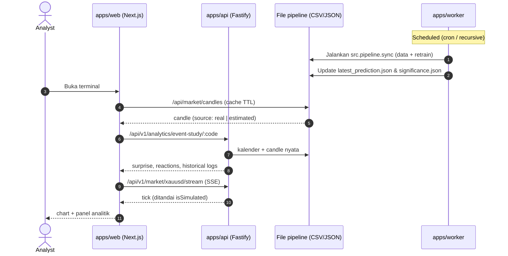
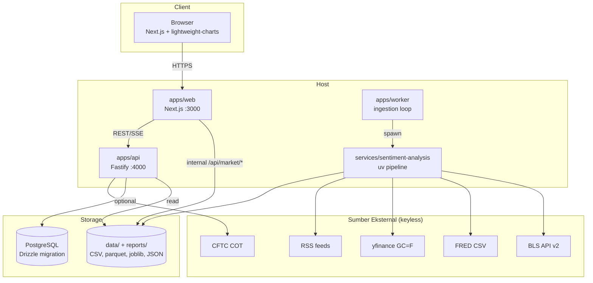

# Arsitektur Sistem Informasi Pasar Emas (XAUUSD) & Analisis Dampak Berita

Dokumen ini menjelaskan arsitektur teknis sistem: monorepo TypeScript (Bun),
service pipeline Python, alur data, dan integrasi model ML.

---

## 1. Struktur Monorepo (Bun + Turborepo)

```text
sistem-informasi-market-xauusd/
├── apps/
│   ├── api/          # Fastify — REST + SSE (port 4000)
│   ├── web/          # Next.js 15 App Router + lightweight-charts (port 3000)
│   └── worker/       # Scheduled ingestion (tsx)
├── packages/
│   ├── types/              # Skema Zod bersama (OHLCV, COT, EconomicRelease, dst.)
│   ├── database/           # Skema Drizzle (PostgreSQL) + drizzle-kit migration
│   ├── core-analytics/     # Surprise, reaction windows, agregasi event study
│   └── financial-clients/  # Kalender, COT CFTC, candle XAUUSD (CSV parser)
├── services/
│   └── sentiment-analysis/ # Pipeline Python (uv): acquire → process → ML
├── docs/                   # PRD, arsitektur, diagram
├── .hermes/plans/          # Rencana perbaikan
├── turbo.json
└── package.json
```

---

## 2. Alur Data & ML (services/sentiment-analysis)

```text
┌──────────────────── ACQUIRE (keyless) ────────────────────┐
│  BLS API v2   : CPI, core CPI, NFP                         │
│  FRED CSV     : core PCE, FOMC target range                │
│  yfinance GC=F: H1 history + intraday 5m/15m               │
│  RSS (9 feed) : berita + sentimen VADER                    │
│  CFTC         : COT report                                 │
└───────────────────────────┬───────────────────────────────┘
                            ▼
┌──────────────────── PROCESS / FEATURES ────────────────────┐
│  harmonize  : merge_asof backward (anti look-ahead)        │
│  features   : TF-IDF, session, temporal, split + embargo   │
│  buckets    : 4H bucket, topic interactions, PIT macro     │
└───────────────────────────┬───────────────────────────────┘
                            ▼
┌──────────────────── RETRAIN & EVALUATE ────────────────────┐
│  train         : champion dipilih by CV (bukan hardcode)   │
│  significance  : p-value, Wilson CI, Pesaran-Timmermann    │
│  eval fair     : baseline makro vs full (sentimen)         │
│  predict       : prediksi 4H terbaru                       │
│  provenance    : manifest sumber & status simulasi          │
└────────────────────────────────────────────────────────────┘
```

Semua artifact membawa metadata *provenance* (`source`, `generated_at`,
`is_simulated`). Bila sumber gagal, nilai yang dikembalikan adalah
`unavailable`/NaN — bukan pengganti karangan.

---

## 3. Integrasi Aplikasi TypeScript



---

## 4. Diagram Deployment



---

## 5. Hubungan Antar Modul

1. **`packages/types`** adalah kontrak data tunggal (Zod) yang dipakai
   `database`, `core-analytics`, `api`, dan `web`.
2. **`packages/financial-clients`** mengisolasi pembacaan data (CSV parser
   tahan-quote, path portabel via `REPO_ROOT`) sehingga ganti sumber data tidak
   mengubah modul analitik.
3. **`packages/core-analytics`** berisi matematika event study murni (tanpa I/O),
   sehingga teruji unit secara terisolasi.
4. **`services/sentiment-analysis`** bersifat otonom: pipeline dapat dijalankan
   tanpa aplikasi TypeScript, dan sebaliknya aplikasi tetap berjalan dengan
   artifact yang sudah ada.
5. **`apps/web`** membaca pipeline output langsung (fallback) selain lewat API,
   sehingga chart tetap cepat walau API analitik sedang mati.

---

## 6. Integritas & Pelaporan

- Setiap angka analitik dapat ditelusuri ke sumbernya lewat
  `data/processed/provenance.json`.
- Model dilatih di atas fitur nyata; hasil yang tidak signifikan dilaporkan
  jujur (`sentiment_adds_value: false`), bukan dipaksa terlihat sebagai *alpha*.
- Regression tests menjaga: anti look-ahead (merge `backward`), provenance,
  signifikansi, dan skema fitur.
