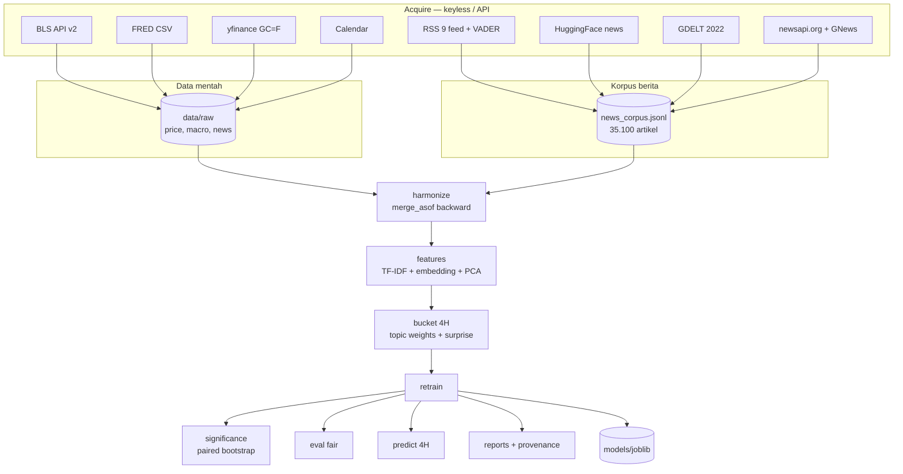
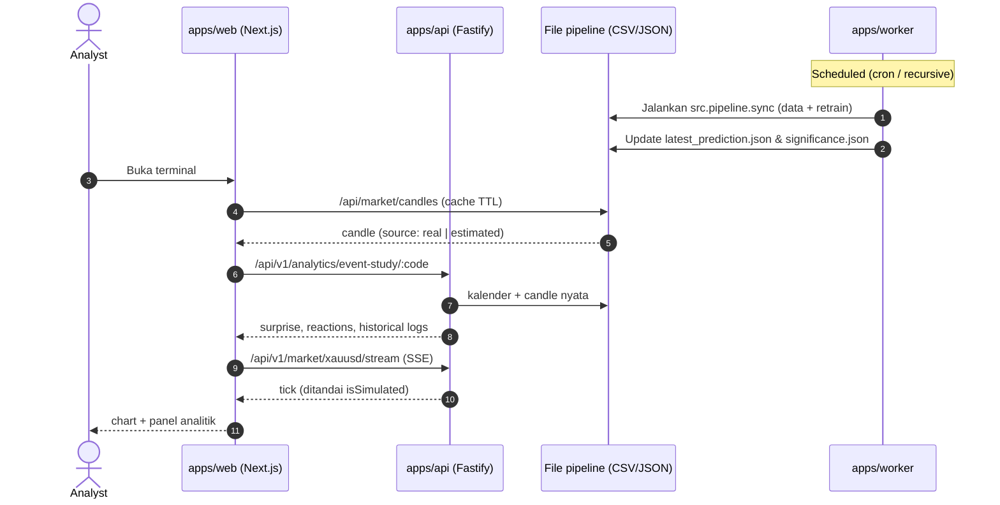
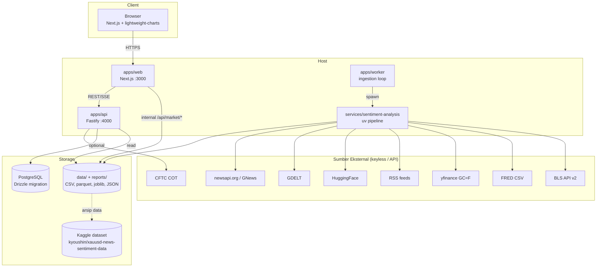
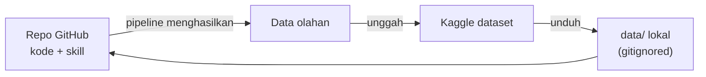

# Arsitektur Sistem Informasi Pasar Emas (XAUUSD) & Analisis Dampak Berita

Dokumen ini menjelaskan arsitektur teknis sistem: monorepo TypeScript (Bun),
service pipeline Python, alur data, dan integrasi model ML.

---

## 1. Struktur Monorepo (Bun + Turborepo)

```text
sistem-informasi-market-xauusd/
├── apps/
│   ├── api/          # Fastify — REST + SSE (port 4000)
│   ├── web/          # Next.js 15 App Router + lightweight-charts (port 3000)
│   └── worker/       # Scheduled ingestion (tsx)
├── packages/
│   ├── types/              # Skema Zod bersama (OHLCV, COT, EconomicRelease, dst.)
│   ├── database/           # Skema Drizzle (PostgreSQL) + drizzle-kit migration
│   ├── core-analytics/     # Surprise, reaction windows, agregasi event study
│   └── financial-clients/  # Kalender, COT CFTC, candle XAUUSD (CSV parser)
├── services/
│   └── sentiment-analysis/ # Pipeline Python (uv): acquire → process → ML
├── docs/                   # PRD, arsitektur, diagram
├── .agents/skills/         # Skill agent (Claude Code / Hermes)
├── turbo.json
└── package.json
```

---

## 2. Alur Data & ML (services/sentiment-analysis)



```text
price → intraday → macro → calendar → news → harmonize
      → features → buckets → retrain → evaluate → predict → provenance
```

Semua artifact membawa metadata *provenance* (`source`, `generated_at`,
`is_simulated`). Bila sumber gagal, nilai yang dikembalikan adalah
`unavailable`/NaN — bukan pengganti karangan.

### 2.1 Pilihan representasi teks

| Tahap | Modul | Keterangan |
|---|---|---|
| Tokenisasi + stemming | `features/text_preprocess.py` | Porter stemmer, stop words, TF-IDF n-gram (1,2) 300 fitur |
| Embedding kalimat | `features/embeddings.py` | sentence-transformers `all-MiniLM-L6-v2` (384 dim), PCA fit on train |
| Reduksi blok | `features/reduce.py` | PCA per blok (macro/topic/interaction/tfidf), 90% varians |
| Bobot topik | `features/topic_weights.py` | SMD return train, clip 0,25–2,0 |

### 2.2 Pipeline realtime

`src/pipeline/realtime.py` menjalankan siklus sync penuh berulang dengan jeda
`--interval` (default 30 menit). Status tercatat di
`data/processed/realtime_status.json`; loop berhenti anggun saat Ctrl+C dan
kegagalan satu siklus tidak menghentikan loop.

---

## 3. Integrasi Aplikasi TypeScript



---

## 4. Diagram Deployment



---

## 5. Hubungan Antar Modul

1. **`packages/types`** adalah kontrak data tunggal (Zod) yang dipakai
   `database`, `core-analytics`, `api`, dan `web`.
2. **`packages/financial-clients`** mengisolasi pembacaan data (CSV parser
   tahan-quote, path portabel via `REPO_ROOT`) sehingga ganti sumber data tidak
   mengubah modul analitik.
3. **`packages/core-analytics`** berisi matematika event study murni (tanpa I/O),
   sehingga teruji unit secara terisolasi.
4. **`services/sentiment-analysis`** bersifat otonom: pipeline dapat dijalankan
   tanpa aplikasi TypeScript, dan sebaliknya aplikasi tetap berjalan dengan
   artifact yang sudah ada.
5. **`apps/web`** membaca pipeline output langsung (fallback) selain lewat API,
   sehingga chart tetap cepat walau API analitik sedang mati.

---

## 6. Integritas & Pelaporan

- Setiap angka analitik dapat ditelusuri ke sumbernya lewat
  `data/processed/provenance.json`.
- Model dilatih di atas fitur nyata; hasil yang tidak signifikan dilaporkan
  jujur (`sentiment_adds_value: false`), bukan dipaksa terlihat sebagai *alpha*.
- Regression tests menjaga: anti look-ahead (merge `backward`), provenance,
  signifikansi, dan skema fitur.

## 7. Repositori & Penyimpanan Data

- **Repo GitHub** (`fiyanz/xauusd-news-sentiment`) hanya berisi **kode**.
  Data dan cache di-gitignore; riwayat pernah di-rewrite dengan
  `git-filter-repo` untuk menghapus cache parquet >100 MB.
- **Kaggle** menyimpan data olahan:
  `kyoushin/xauusd-news-sentiment-data` (korpus, fitur, bucket, harga, makro).
- **Skill agent** dipusatkan di `.agents/skills/`; `.claude/` dan `.hermes/`
  di-gitignore.


