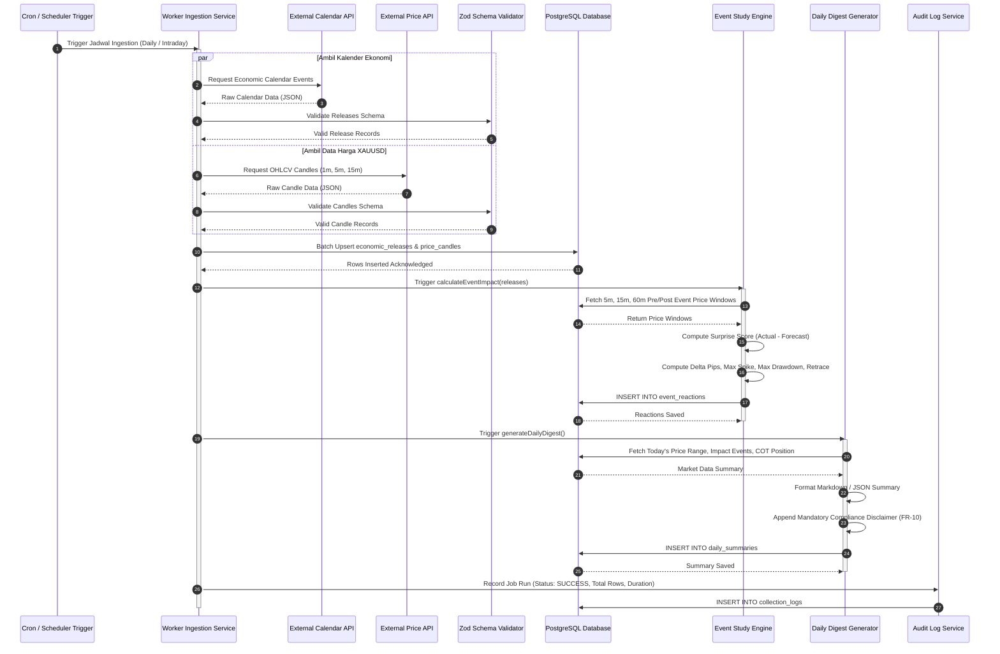
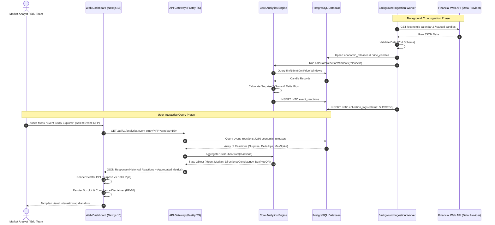
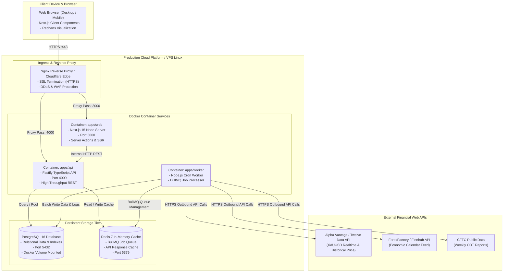

# Arsitektur Sistem Informasi Pasar Emas (XAUUSD) & Analisis Dampak Berita

Dokumen ini menjelaskan struktur arsitektur teknis, desain monorepo TypeScript, dan diagram pemodelan sistem formal (**Activity Diagram**, **Sequence Diagram**, dan **Deployment Diagram**).

---

## 1. Desain Struktur Monorepo (Turborepo + pnpm)

Sistem menggunakan arsitektur monorepo modular untuk memastikan integritas tipe (*end-to-end type safety*), *code reuse*, dan isolasi dependensi:

```text
sistem-informasi-market-xauusd/
├── apps/
│   ├── web/                     # Next.js 15 App Router (Dashboard UI, Recharts, Server Actions)
│   ├── api/                     # Fastify / Hono TS (High-throughput REST API Service)
│   └── worker/                  # BullMQ / Cron Ingestion Service (Background Tasks)
├── packages/
│   ├── database/                # Drizzle ORM Schema, PostgreSQL Client, Migrations
│   ├── core-analytics/          # Event Study Math Engine, Surprise Formula, Statistics
│   ├── financial-clients/       # Ingestion Adapters (Alpha Vantage, Twelve Data, COT Parser)
│   ├── types/                   # Zod Schemas, Domain Enums, Shared Interfaces
│   ├── ui/                      # Shared UI Components (Tailwind v4, Radix Primitives)
│   ├── eslint-config/           # Shared Linting Rules
│   └── tsconfig/                # Base TypeScript Configs (Strict Mode)
├── docs/                        # Dokumentasi Sistem, PRD & Architecture
├── turbo.json                   # Pipeline task caching configuration
├── pnpm-workspace.yaml          # Workspace mapping
└── package.json                 # Monorepo root manifest
```

---

## 2. Activity Sequence Diagram (Pipeline Otomatisasi & Ringkasan Harian)

Diagram sekuens aktivitas di bawah menggambarkan seluruh tahapan alur kerja proses bisnis (*activity workflow*) dari trigger cron scheduler, ingestion data, validasi, kalkulasi event study, hingga publikasi daily digest:



---

## 3. Sequence Diagram

Diagram sekuens ini memodelkan interaksi saat Market Analyst membuka **Event Study Explorer** di web dashboard untuk menganalisis dampak rilis NFP terhadap XAUUSD:



---

## 4. Deployment Diagram

Diagram penyebaran sistem menggambarkan topologi infrastruktur fisik/container di lingkungan produksi:



---

## 5. Ringkasan Hubungan Antar Modul

1. **`packages/types`** menjadi jangkar kontrak data tunggal yang diimpor oleh `packages/database`, `packages/core-analytics`, `apps/api`, dan `apps/web`.
2. **`packages/financial-clients`** mengisolasi integrasi API eksternal sehingga pergantian provider data harga (misal dari Twelve Data ke Alpha Vantage) tidak mempengaruhi modul analitik atau database.
3. **`apps/worker`** bertanggung jawab menjaga ketersediaan data secara otonom tanpa membebani server web interaktif.
4. **`apps/web`** berfokus pada pengalaman pengguna yang cepat melalui *React Server Components* (RSC) dan rendering visualisasi data pasar emas yang bersih.
