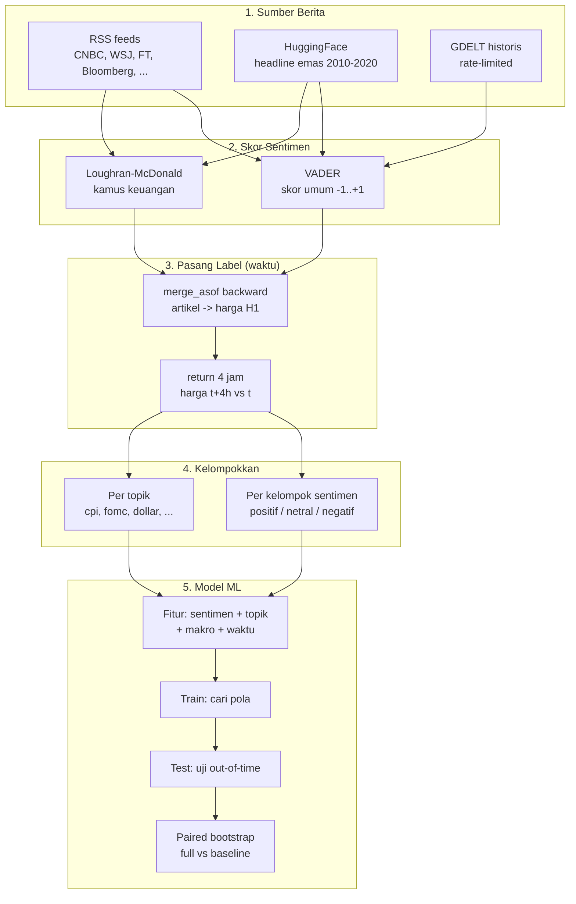
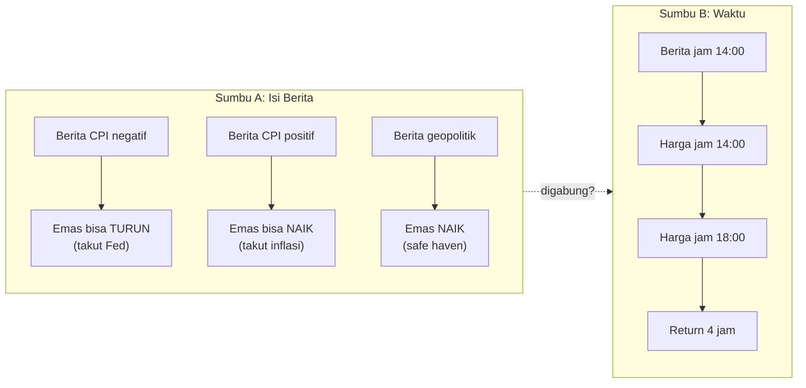
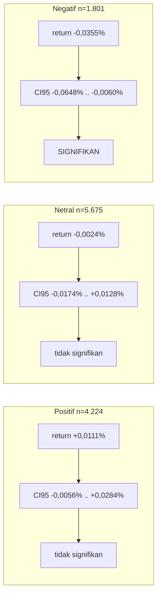
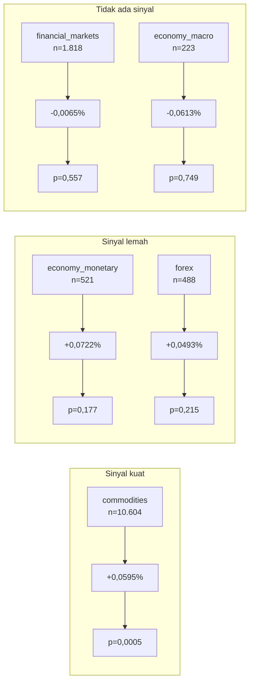
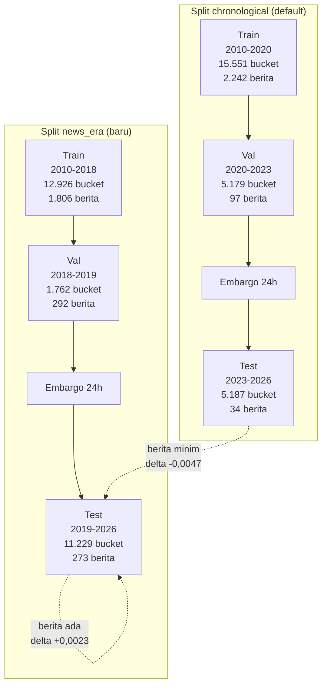
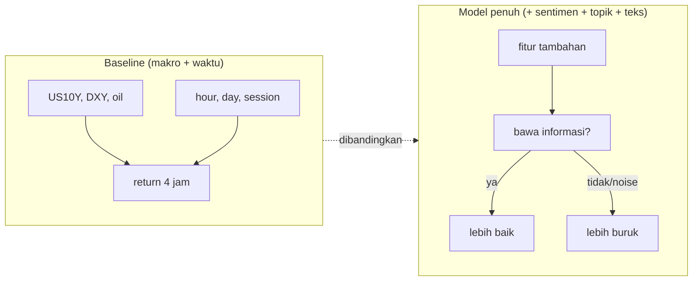
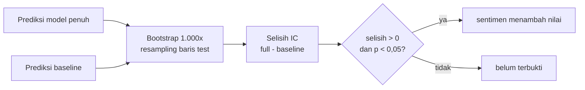
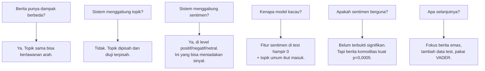

# Cara Kerja Analisis Sentimen Berita Emas (XAUUSD)

Dokumen ini menjelaskan **apa yang sebenarnya dikerjakan sistem** terhadap berita,
dengan bahasa sederhana dan visualisasi. Tidak ada rumus rumit di awal — fokus ke intuisi.

---

## 0. Diagram alur lengkap

---

## 1. Pertanyaan awalmu

> "Setiap berita punya dampak berbeda-beda. Misal berita CPI bisa berdampak buruk
> dan bisa berdampak baik. Kalau digabung per kategori, jadi campuran yang
> berdampak naik-turun dan jadi kacau. Bagaimana cara kerjanya?"

Pertanyaan ini **tepat**. Dan jawabannya: **betul, berita tidak bisa digabung
sembarangan**. Sistem sekarang justru mencampur dua hal yang berbeda, dan itu
yang membuat hasilnya "kacau". Mari kita bedah.

---

## 2. Dua hal yang berbeda: "isi berita" dan "waktu"

Ada dua sumbu yang harus dipisahkan:

**Kesalahan yang sering terjadi:** mencampur sumbu A dan B. Misalnya:
- Berita "CPI naik" → bisa bikin emas **naik** (takut inflasi) atau **turun**
  (takut Fed naikkan suku bunga).
- Berita "Fed turunkan suku bunga" → emas cenderung **naik**.
- Berita "geopolitik memanas" → emas cenderung **naik** (safe haven).
- Jadi **topik yang sama bisa berdampak berlawanan**, tergantung isi/nada berita.

### Sumbu B — Waktu (kapan berita terbit)
- Harga emas bergerak terus-menerus. Untuk tahu "dampak berita", kita lihat harga
  **setelah** berita terbit.
- Berita jam 14:00 → kita lihat harga jam 18:00 (4 jam kemudian).

**Kesalahan yang sering terjadi:** mencampur sumbu A dan B. Misalnya:
- Mengelompokkan semua berita CPI jadi satu → campuran "CPI bikin naik" dan
  "CPI bikin turun" → rata-ratanya mendekati nol → seolah tidak ada sinyal.
- Padahal sinyalnya ada, tapi **tertutup oleh arah yang berlawanan**.

---

## 3. Cara kerja sistem saat ini (langkah demi langkah)

### Langkah 1 — Ambil berita
- Sumber: RSS (CNBC, WSJ, FT, Bloomberg, dll) + HuggingFace (headline emas
  2010–2020) + GDELT (historis, kena rate-limit).
- Setiap artikel punya: judul, waktu terbit, URL, topik, skor sentimen.

### Langkah 2 — Skor sentimen
- **VADER**: skor umum (−1 sampai +1). Mengenali kata "surge", "fall", "crisis".
- **Loughran-McDonald**: kamus khusus keuangan (mis. "liability", "write-down").
- Skor ini **tidak membedakan topik**. Berita CPI negatif dan berita geopolitik
  negatif dapat skor serupa.

### Langkah 3 — Pasang label (waktu)
- Setiap artikel dipasangkan dengan harga emas **4 jam setelah** terbit.
- Hitung return: `(harga_4h − harga_sekarang) / harga_sekarang`.
- Ini yang disebut **anti look-ahead**: kita tidak memakai harga masa depan
  untuk menebak masa lalu.

### Langkah 4 — Kelompokkan berita
Ada **dua cara** yang dipakai sistem, dan ini kunci perbedaan:

#### Cara 1 — Per kelompok sentimen (yang kamu maksud)
- Kelompok **positif**: skor > +0,05
- Kelompok **netral**: skor antara −0,05 dan +0,05
- Kelompok **negatif**: skor < −0,05
- Hitung rata-rata return 4 jam per kelompok.

**Hasil (11.700 artikel):**

| Kelompok | Jumlah | Return 4 jam rata-rata | CI95 |
|---|---|---|---|
| positif | 4.224 | +0,0111% | [−0,0056%, +0,0284%] |
| netral | 5.675 | −0,0024% | [−0,0174%, +0,0128%] |
| negatif | 1.801 | **−0,0355%** | [−0,0648%, −0,0060%] |

**Baca:** berita negatif → emas cenderung turun (signifikan). Berita positif →
emas cenderung naik, tapi belum signifikan. Netral → di tengah.

#### Cara 2 — Per topik (yang kamu khawatirkan "jadi campuran")
- Topik: cpi, fomc, yield, payrolls, inflation, dollar, safehaven.
- Untuk tiap topik, hitung rata-rata return berita positif vs negatif.

**Hasil (VADER):**

| Topik | n | Positif vs negatif | p-value |
|---|---|---|---|
| commodities | 10.604 | +0,0595% | **0,0005** |
| economy_monetary | 521 | +0,0722% | 0,177 |
| forex | 488 | +0,0493% | 0,215 |
| financial_markets | 1.818 | −0,0065% | 0,557 |
| economy_macro | 223 | −0,0613% | 0,749 |

**Baca:** topik **commodities** (emas) punya sinyal kuat dan konsisten. Topik
**financial_markets** (umum) tidak ada sinyal — karena campuran berita saham,
bunga, dll yang memang tidak spesifik ke emas.

---

## 4. Jawaban atas kekhawatiranmu

> "Kalau per kategori jadi campuran yang berdampak naik-turun dan jadi kacau."

**Benar, dan ini memang masalah nyata.** Tapi perhatikan:

1. **Sistem tidak menggabungkan topik jadi satu.** Topik dipisah, dan tiap topik
   diuji terpisah. Jadi "campuran" tidak terjadi di level topik.

2. **Yang campur aduk adalah level sentimen.** Kalau kita kelompokkan semua
   berita (semua topik) per sentimen, maka:
   - Berita CPI negatif (emas turun) + berita geopolitik negatif (emas naik)
     → digabung → saling meniadakan.
   - Itu sebabnya analisis "per kelompok sentimen" bisa menghasilkan rata-rata
     yang kecil: **sinyal ada, tapi arah berlawanan tertutup**.

3. **Bukti dari data:**
   - Per kelompok sentimen: negatif −0,0355% (signifikan), positif +0,0111%
     (tidak signifikan). Berarti sinyal negatif lebih bersih; sinyal positif
     mungkin tertutup oleh berita yang berdampak berlawanan.
   - Per topik: commodities kuat (p=0,0005), financial_markets nol (p=0,557).
     Berarti **spesifisitas topik menentukan** apakah sinyal terlihat.

4. **Kesimpulan sementara:** berita yang **spesifik soal emas** (komoditas)
   punya dampak yang konsisten. Berita umum (pasar keuangan) tidak. Ini
   menjelaskan kenapa model "kacau": model memakai semua topik sekaligus,
   termasuk yang tidak relevan.

---

## 5. Cara kerja model ML (bagian yang membingungkan)

Model ML (Ridge, XGBoost, dll) bekerja seperti ini:

1. **Fitur** (input): skor sentimen, topik, makro (US10Y, DXY, oil), waktu.
2. **Target** (output): return 4 jam ke depan.
3. **Training**: cari pola yang menghubungkan fitur → target, pakai data lama.
4. **Test**: pakai data baru (waktu yang lebih akhir) untuk menguji apakah pola
   masih berlaku.

### Masalah utama: split waktu vs isi berita

- Split **chronological** (default): train 2010–2020, test 2023–2026.
  - Berita HF (2010–2020) ada di **train**.
  - Test (2023–2026) **hampir tidak ada berita** (34 bucket).
  - Akibatnya: di test, fitur sentimen hampir semua 0 → model praktis menebak
    tanpa sentimen. Jadi delta "model penuh vs baseline" tidak menguji sentimen.
- Split **news_era** (baru): train 2010–2018, val 2018–2019, test 2019–2026.
  - Test punya **273 bucket berita** (vs 34).
  - Delta jadi positif (+0,0023), tapi p=0,326 → belum signifikan.

### Kenapa model penuh kadang lebih buruk dari baseline?

- Baseline = model tanpa sentimen (hanya makro + waktu).
- Model penuh = baseline + sentimen + topik + teks.
- Bila fitur tambahan **tidak membawa informasi** (atau justru noise), model
  penuh bisa lebih buruk. Ini yang terjadi: delta IC −0,0047 (chronological).
- Di news_era, delta jadi positif (+0,0023) → sentimen mulai membantu, tapi
  belum signifikan.

### Uji kejujuran: paired bootstrap

- Kita tidak puas dengan "model penuh signifikan" (itu bisa terjadi karena
  fitur makro, bukan sentimen).
- Kita uji: **apakah model penuh benar-benar mengungguli baseline** pada baris
  test yang sama? Bootstrap 1.000 resampling, hitung selisih IC.
- Hasil: delta +0,0023, p=0,326 → belum signifikan. Jadi klaim "sentimen
  menambah nilai" **belum bisa diajukan**.

---

## 6. Apa yang sebaiknya dilakukan (rekomendasi)

Berdasarkan temuan di atas, urutan yang paling masuk akal:

### Prioritas 1 — Pisahkan topik emas dari topik umum
- Fitur sentimen **hanya untuk berita yang benar-benar soal emas** (komoditas).
- Berita umum (financial_markets) dibuang atau dibobot rendah.
- Ini langsung mengurangi "campuran" yang kamu khawatirkan.

### Prioritas 2 — Jangan kelompokkan berita berlawanan jadi satu
- Analisis per topik sudah benar. Tapi untuk model, pertimbangkan:
  - Fitur `sentiment × topik` (interaksi) — sudah ada, tapi bisa dipertajam.
  - Atau model terpisah per topik (model emas vs model makro).

### Prioritas 3 — Tambah berita di periode test
- Test 2019–2026 masih minim berita (273 bucket, terkonsentrasi 2019–2020).
- Tambah sumber berita 2019–2025 (mis. dataset HF lain, feed tambahan) supaya
  p-value turun.

### Prioritas 4 — Pakai VADER, bukan LM (untuk sekarang)
- VADER konsisten signifikan (p=0,007 pada analisis dampak).
- LM hanya mengenai 23% artikel → sinyal hilang.

---

## 7. Ringkasan sederhana

| Hal | Penjelasan |
|---|---|
| Berita punya dampak berbeda | Ya. Bahkan topik sama bisa berlawanan arah. |
| Sistem menggabung topik? | Tidak. Topik dipisah dan diuji terpisah. |
| Sistem menggabung sentimen? | Ya, di level "positif/negatif/netral" — ini yang bisa meniadakan sinyal. |
| Kenapa model kacau? | Fitur sentimen di test hampir 0 (split chronological) + topik umum ikut masuk. |
| Apakah sentimen berguna? | Belum terbukti signifikan. Tapi berita komoditas punya sinyal kuat (p=0,0005). |
| Apa selanjutnya? | Fokus ke berita emas, tambah data test, pakai VADER. |

---

## 8. Glosarium

- **Return 4 jam**: persen perubahan harga emas 4 jam setelah berita terbit.
- **CI95**: interval kepercayaan 95%. Bila CI tidak mencakup 0, hasil signifikan.
- **p-value**: peluang hasil muncul kebetulan. p < 0,05 = signifikan.
- **Bootstrap**: teknik resampling untuk menguji signifikansi tanpa asumsi
  distribusi normal.
- **Anti look-ahead**: aturan bahwa fitur hanya boleh memakai informasi yang
  sudah ada saat itu (tidak boleh membocorkan masa depan).
- **Baseline**: model pembanding tanpa fitur sentimen.
- **Paired bootstrap**: uji apakah model penuh mengungguli baseline pada baris
  yang sama.
